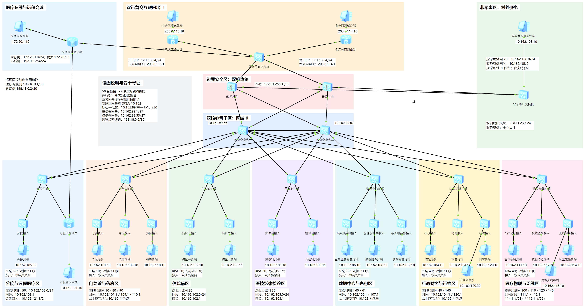
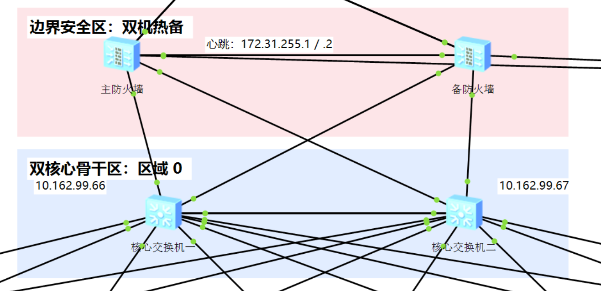
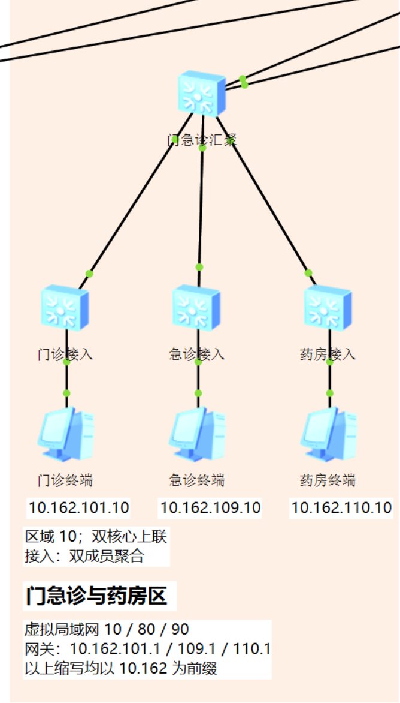

<div align="center">

# 🏥 eNSP 医院园区网络实验

**从业务分区到故障切换：一套带工程、配置、报告和原始证据的网络仿真实践。**

Hospital Campus Network · Huawei eNSP

[](LICENSE)


[查看报告](output/hospital-network/report.pdf) · [打开工程目录](output/hospital-network/工程/) · [浏览设备配置](output/hospital-network/配置/) · [核对测试结果](output/hospital-network/测试结果.csv)

</div>



> 围绕门急诊、住院、医技、数据中心、行政运维、医疗物联及分院互联，实践多区域 OSPF、VLAN 隔离、LACP、VRRP、HRP、NAT 和 IPsec。仓库同时保留构建与取证脚本，方便追溯实验过程。

[项目看点](#features) · [快速开始](#quick-start) · [地址规划](#address-plan) · [验收记录](#validation) · [仓库导航](#repository) · [脚本说明](#scripts)

<a id="features"></a>

## ✨ 项目看点

| 方向 | 实验内容 |
| :--- | :--- |
| 分层组网 | 双核心、七个业务汇聚区、接入交换机与双上联，提供逐端口链路清单 |
| 路由与冗余 | 多区域 OSPF、核心 VRRP、Eth-Trunk/LACP、防火墙 HRP 主备 |
| 业务隔离 | 访客、办公、医疗物联、安防、分院、管理与备份网络的 ACL 和防火墙策略 |
| 外联接入 | 主备公网、NAT、DMZ、医疗专线与远程会诊 IPsec 备用通道 |
| 证据留存 | 原始控制台记录、PCAPNG、界面截图、故障注入与恢复记录 |
| 报告与工具 | DOCX/PDF 报告、34 份最终设备运行配置，以及 Python 自动化脚本 |

设备清单共 **58 台设备、92 条物理链路**：28 台 S5700、4 台 AR2220、2 台 USG5500，以及 24 台模拟终端。其中 34 台为网络设备。

<a id="quick-start"></a>

## 🚀 快速开始

### 1. 获取仓库

```powershell
git clone https://github.com/ScyPolit/eNSP_HospitalNetwork.git
cd eNSP_HospitalNetwork
```

只阅读方案时，直接打开 [PDF 报告](output/hospital-network/report.pdf) 和 [高清拓扑](output/hospital-network/拓扑图/医院园区网-高清真实拓扑.png) 即可。

### 2. 准备仿真环境

| 项目 | 本项目记录使用的环境 |
| :--- | :--- |
| 操作系统 | Windows |
| 仿真平台 | 经典 eNSP 1.3.00.100 |
| 虚拟化组件 | VirtualBox 5.2.26 |
| 设备模型 | S5700、AR2220、USG5500，以及 eNSP PC |
| 抓包查看 | Wireshark，可用于打开仓库中的 `.pcapng` |

以上为实验记录中的环境组合；其他版本的兼容性需要自行验证。eNSP、VirtualBox 和设备镜像需自行获取并正确安装、注册。

### 3. 打开完整工程

在 eNSP 中打开：

```text
output/hospital-network/工程/hospital-network.topo
```

**请完整保留 `.topo` 同级的 34 个设备编号目录。** 其中的 `flash.efz`、`vrpcfg.zip` 是恢复启动配置所需的工程文件，复制单个 `.topo` 无法完整恢复实验。

启动设备后，等待 OSPF、HRP 与链路聚合收敛。图中中文显示名与 CLI 系统名的对应关系见 [设备清单](output/hospital-network/设备清单.csv)，接口连接见 [链路清单](output/hospital-network/链路清单.csv)。如果画布显示不全，可用工具栏缩小视图。

修改配置后，先在设备中执行 `save`，再在 eNSP 中保存工程，以保留设备启动配置。

### 4. 复核连通性与隔离

按 [30 项测试矩阵](output/hospital-network/测试结果.csv) 逐项检查。例如：

| 源终端 | 目的地址 | 预期 |
| :--- | :--- | :--- |
| 门诊终端 OPD-PC | `10.162.106.10`（HIS 诊断地址） | 允许 |
| 访客终端 GUEST-PC | `10.162.106.10` | 禁止 |
| 访客终端 GUEST-PC | `203.0.113.10`（模拟公网） | 经 NAT 允许 |
| 分院终端 BRANCH-PC | `203.0.113.10` | 禁止 |
| 堡垒机 BASTION | `10.162.99.65`（设备管理诊断地址） | 允许 |

`203.0.113.10` 等地址指向仿真拓扑中的终端；“公网访问”表示实验内的模拟外联。

<a id="address-plan"></a>

## 🗺️ 业务分区与地址规划

以下为 [原始设备与链路清单](lab_inventory.json) 中的业务网段。骨干互联、管理环回及外联地址以最终配置和链路清单为准。

| 业务分区 | VLAN | 网段 | OSPF 区域 |
| :--- | :--- | :--- | :--- |
| 门诊 / 急诊 / 药房 | 10 / 80 / 90 | `10.162.101.0/24`、`10.162.109.0/24`、`10.162.110.0/24` | Area 10 |
| 住院病区 | 20 | `10.162.102.0/24` | Area 20 |
| 医技影像与检验 | 30 | `10.162.103.0/24` | Area 20 |
| HIS、PACS 等服务器 | 60 | `10.162.106.0/24` | Area 30 |
| 数据备份 | 61 | `10.162.107.0/24` | Area 30 |
| 行政与财务 | 40 | `10.162.104.0/24` | Area 40 |
| 运维与堡垒机 | 160 | `10.162.120.0/24` | Area 40 |
| 医疗物联 / 视频监控 | 100 / 110 | `10.162.111.0/24`、`10.162.112.0/24` | Area 40 |
| 员工无线 / 访客无线 | 120 / 140 | `10.162.114.0/23`、`10.162.116.0/22` | Area 40 |
| 分院互联 | 50 | `10.162.105.0/24` | Area 50 |

<details>
<summary><strong>展开查看核心与门急诊分区截图</strong></summary>





图像取自 eNSP 界面。更多区域截图与来源记录见 [真实截图目录](output/hospital-network/拓扑图/真实截图/)。原始全屏截图可能含个人窗口标题，仅留在本地；来源记录保留了原始取图方法。

</details>

<a id="validation"></a>

## ✅ 已有验收记录

下列结果来自仓库保存的实验记录，作为复核入口；本次仓库整理未重新启动仿真。

| 检查项目 | 已记录结果 | 依据 |
| :--- | :--- | :--- |
| 业务连通与隔离 | 30 / 30 项通过 | [测试结果](output/hospital-network/测试结果.csv) |
| 重启后连通与隔离复核 | 7 / 7 项通过 | [最终验证记录](output/hospital-network/验收记录/final-validation.json) |
| 网络设备启动身份 | 34 / 34 台核对通过 | [最终验证记录](output/hospital-network/验收记录/final-validation.json) |
| 故障切换 | 记录核心 VRRP、LACP 单成员故障、HRP、切换后新建 NAT 会话、IPsec 备用路径与汇聚备用上联 | [故障实验记录](output/hospital-network/验收记录/failover-results.json) |
| 完整配置收录 | 34 台设备、2,793 行有效配置 | [完整性核对记录](output/hospital-network/验收记录/full-config-completeness.json) |

可结合 [最终设备配置](output/hospital-network/配置/)、[原始抓包](output/hospital-network/证据/原始抓包/) 和 [原始控制台记录](output/hospital-network/证据/原始控制台记录/) 交叉核对。

### 验证范围与已知限制

- HIS、PACS、Web 等服务由 eNSP 终端代表，主要验证网络连通与访问隔离；端口策略配置不代表真实 HTTP、HTTPS 或数据库应用已通过测试。
- 已记录防火墙切换后的**新建 NAT 会话**恢复；既有业务会话能否无损迁移仍需验证。
- 当前 USG5500 镜像存在虚拟 MAC 收包兼容性问题，DMZ 终端采用 `10.162.108.2` 实地址网关；DMZ 端到端自动主备切换仍需验证。
- 员工与访客无线业务通过 VLAN 和模拟终端表达，未据此验证真实 AP、AC 或射频行为。
- 配置及日志保留实验认证信息与本机路径，使用时应调整实验凭据、路径与端口。

<a id="repository"></a>

## 📂 仓库导航

```text
.
├── README.md                     # 项目介绍与复现入口
├── LICENSE                       # MIT 许可证
├── report-template.docx            # 去除个人信息的报告模板
├── lab_inventory.json            # 设备、链路、控制台端口与 VLAN 清单
├── *.py                          # 构建、配置、截图、报告与验证脚本
├── evidence/                     # 过程证据、抓包、渲染和核对记录
└── output/
    └── hospital-network/         # 唯一公开交付目录
    │   ├── 工程/                 # .topo 与设备启动配置
    │   ├── 配置/                 # 最终运行配置
    │   ├── 拓扑图/               # 总览与分区真实截图
    │   ├── 证据/                 # 控制台、抓包与验证截图
    │   ├── 验收记录/             # 结构化验证结果
    │   ├── report.pdf     # 可直接阅读的报告
    │   ├── report.docx            # 可编辑报告
    │   └── *.csv / SHA256SUMS.txt # 设备、链路、测试与文件校验清单
```

Git 排除 `output/历史版本/`、`output/` 直属的汇总 ZIP，以及 `.opencode/`、`.作业核查/`、`__pycache__/` 和 Python 字节码。设备目录内的 `vrpcfg.zip` 正常保留。

公开版只保留上述一套报告与工程。报告已移除课程封面、评分页以及姓名、学号、班级信息，文件名使用通用名称；原始提交副本、全屏桌面截图、旧报告渲染与核对缩略图仅保留在本地，不纳入 Git。

<a id="scripts"></a>

## 🛠️ 脚本使用说明

**使用现成工程不需要运行 Python 脚本。** 脚本保留了实验演进过程，部分在导入或执行时就会连接设备、覆盖输出或操作桌面，使用前应阅读文件内容，并备份工程。

| 用途 | 主要文件 |
| :--- | :--- |
| 拓扑与布局 | `build_full_lab.py`、`prepare_layout.py`、`screen_layout.py` |
| 控制台与基础配置 | `configure_lab.py`、`collect_lab.py`、`lab_console.py` |
| 安全、VPN 与兼容修正 | `secure_lab.py`、`configure_vpn.py`、`full_config_v2.py`、`medical_compatibility.py`、`nat_disjoint.py` |
| 测试与状态留存 | `test_matrix.py`、`failover_tests.py`、`final_validation.py`、`persist_final.py` |
| 界面截图与取证 | `native_ui.py`、`capture_real_topologies.py`、`capture_single_regions.py`、`review_captures.py` |
| 报告生成与检查 | `build_report.py`、`word_render.py`、`verify_full_report.py`、`qa_student_report.py` |
| 工程与交付整理 | `package_topology.py`、`assemble_delivery.py` |

需要研究脚本时，建议在仓库外建立独立虚拟环境，再安装使用到的第三方 Python 包：

```powershell
python -m pip install python-docx lxml PyMuPDF Pillow pyautogui pywinauto pywin32
```

这些依赖用于不同脚本，仓库尚未提供锁定版本的环境文件。使用前还需处理以下环境条件：

1. `word_render.py` 通过 COM 调用已安装的 Microsoft Word；截图脚本需要交互式 Windows 桌面、eNSP 窗口和适配的屏幕布局。
2. `lab_console.py`、`save_ar.py` 依赖仓库外的 `ensp_mcp_server.console.HuaweiConsole`，当前使用作者机器上的路径。需自行提供对应模块并调整 `sys.path`；此模块不包含在上述 pip 安装命令内。
3. 设备控制台连接使用 `127.0.0.1` 和 `lab_inventory.json` 中的端口，重建工程后应重新核对。
4. 部分证据 JSON 记录旧工作目录的绝对路径，部分报告整理脚本引用阶段性文件名。迁移时应按当前目录调整；完整交付目录中的相对证据路径优先用于阅读。
5. `build_full_lab.py` 会重新生成拓扑与清单，`assemble_delivery.py` 会写入交付目录并生成汇总 ZIP。它们属于构建步骤，汇总 ZIP 会被 Git 忽略。

## 🤝 参与改进

欢迎通过 [Issues](https://github.com/ScyPolit/eNSP_HospitalNetwork/issues) 反馈复现问题，或提交 Pull Request。问题描述建议包含环境版本、设备系统名、预期与实际结果，以及对应命令输出或截图。

修改网络行为时，请一并更新受影响的设备配置、测试场景与结果记录。可继续完善的方向包括真实应用服务验证、DMZ 自动切换验证，以及脚本路径和参数的可移植性。

## 📄 开源许可

作者：**[ScyPolit](https://github.com/ScyPolit)**。

本项目原创代码与原创文档内容采用 [MIT License](LICENSE)，使用、修改或分发时请保留版权及许可声明。课程模板及其中的第三方内容、厂商商标、软件与设备镜像的权利归各自权利人所有，不因本项目的 MIT 许可而改变。
